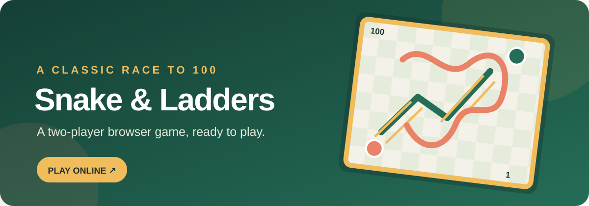

<div align="center">



# 🎲 Snake & Ladders

[](https://remarkable-bunny-c2be1e.netlify.app)
[](https://github.com/kpagar1010-creator/snake-and-ladders/stargazers)
[](https://developer.mozilla.org/en-US/docs/Web/JavaScript)
[](https://webassembly.org/)

**A classic two-player race to 100—play instantly in your browser.**

[Play the live game](https://remarkable-bunny-c2be1e.netlify.app) · [Report a bug](https://github.com/kpagar1010-creator/snake-and-ladders/issues/new) · [Suggest a feature](https://github.com/kpagar1010-creator/snake-and-ladders/issues/new)

</div>

## About

Snake & Ladders is a lightweight, two-player browser game built with HTML, CSS, and JavaScript. No install or dependencies are required to play. The game also includes an optional C implementation that can be compiled to WebAssembly using Emscripten.

## Features

- Take turns rolling the dice and race to square 100
- Climb ladders, slide down snakes, and aim for an exact finish
- Play on desktop or mobile with a responsive interface
- Start playing immediately with the built-in JavaScript rules
- Experiment with the optional C/WebAssembly game engine

## Quick start

**Play online:** [remarkable-bunny-c2be1e.netlify.app](https://remarkable-bunny-c2be1e.netlify.app)

**Run locally:** clone or download this repository, then open `index.html` in a browser. Or start a local web server from the project directory:

```sh
python -m http.server 8000
```

Open [http://localhost:8000](http://localhost:8000). The JavaScript version also works when opening `index.html` directly; use a local server for the optional WebAssembly build.

## How to play

1. Players take turns rolling the six-sided die.
2. Landing on a ladder moves you up; landing on a snake moves you down.
3. Reach square 100 with an exact roll to win. A roll past 100 leaves you in place.

## Optional: build with C and WebAssembly

1. Install and activate the [Emscripten SDK](https://emscripten.org/docs/getting_started/downloads.html).
2. In the project directory, compile the C game logic:

   ```sh
   emcc game.c -O2 -s WASM=1 -s MODULARIZE=1 -s EXPORT_NAME=SnakeGame -s EXPORTED_FUNCTIONS='["_game_reset","_game_move","_game_get_position","_game_get_current_player","_game_get_winner","_game_get_last_roll","_game_get_event_type","_game_get_event_from","_game_get_event_to"]' -o game_module.js
   ```

3. Serve the project over HTTP and open it in your browser. The generated `game_module.js` and `game_module.wasm` are optional; without them, gameplay falls back to JavaScript.

## Project structure

| File | Purpose |
| --- | --- |
| `index.html` | Game page and interface structure |
| `style.css` | Responsive visual styles |
| `app.js` | Board rendering, controls, and JavaScript game logic |
| `game.c` | Game state and rules for the optional WebAssembly build |
| `assets/snake-and-ladders-banner.svg` | README banner artwork |

## Built with

HTML · CSS · JavaScript · C · WebAssembly (optional)

## Contributing

Bug reports, feature ideas, and pull requests are welcome. [Open an issue](https://github.com/kpagar1010-creator/snake-and-ladders/issues/new) to report a problem or suggest an improvement. For code changes, please describe what you changed and how you tested it.

If you enjoy the game, consider giving the repository a ⭐—it helps others find the project.
